<p align="center">
  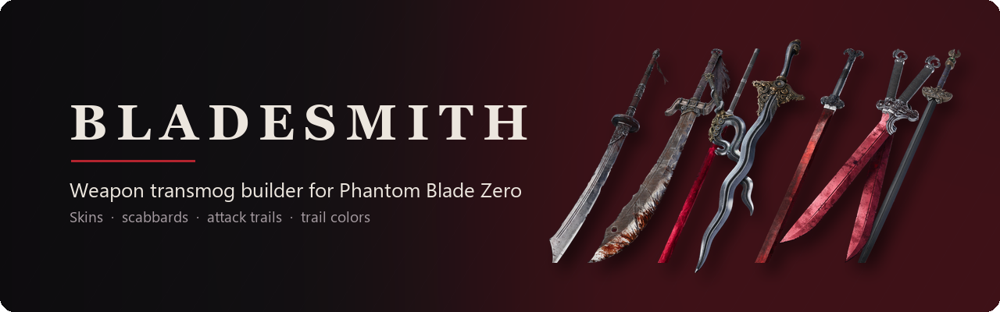
</p>

<p align="center">
  <a href="LICENSE"></a>
  
  
  
  <a href="https://www.nexusmods.com/phantombladezero/mods/447"></a>
</p>

Bladesmith lets you keep the weapon you play with and change how it looks. Pick the base weapon for its stats, perks and
moveset, pick the weapon whose look you want, and Bladesmith builds a pak mod for your `~mods` folder: the new blade
model, its scabbard, the attack trails you chose and, if you like, recolored trails.

It reads everything from your own copy of the game and writes only the few files it changes. Nothing from the game
ships with Bladesmith, and after a game patch you rebuild your pak from the updated files.

<p align="center">
  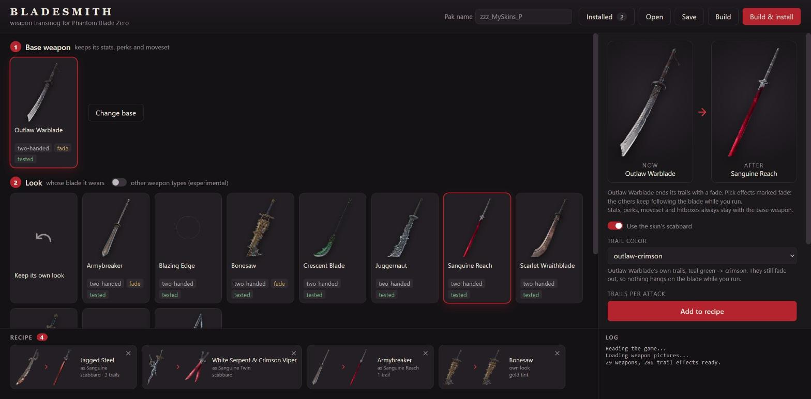
</p>

## What it does

- Puts any player weapon's blade model on another weapon of the same type. Dual weapons are handled blade by blade.
  The old model's offset and scale are removed, so the new blade sits right in the hand and in the scabbard.
- Adds the skin's scabbard. Sanguine, Sanguine Reach and Sanguine Twin have one. The base weapon must carry a scabbard
  in the same spot: the game crashes when a scabbard moves somewhere else, so Bladesmith leaves those out.
- Swaps the trail of each attack (standard combo, Sha-Chi combo, charged attack, thrusts) for any of about 300 trail
  effects in the game, enemy ones included. The blood trails in Sanguine Skins come from an enemy.
- Recolors trails with color presets, which write the new colors into copies of the effects. The first preset turns
  Outlaw Warblade's teal trails crimson. An experimental tint moves any trail to one of six hues.
- Changes one color of a blade (experimental). Pick one of the look's colors, for example Sanguine's red, and what it
  becomes. Only that weapon changes, because it gets its own copy of the texture. Hilt, blade and scabbard use one
  texture, so every part painted in that color changes together. Plain steel and wood have no color to pick.
- Shows the game's own inventory render on every weapon card and a before/after preview of the weapon you are editing.
- Warns before you build. Some weapons end their trails with a fade (Outlaw Warblade and eight others), and a trail
  without fade support keeps following the blade while you run, so the trail list marks the ones that fade. Skins from
  another weapon type stay hidden behind an experimental switch, because hitboxes and animations always come from the
  base weapon.

Stats, perks, movesets and hitboxes never change. Enemies and bosses keep their own weapons and effects: Bladesmith
only edits the player's weapon files and puts new effects in a folder of its own.

<table>
  <tr>
    <td width="50%">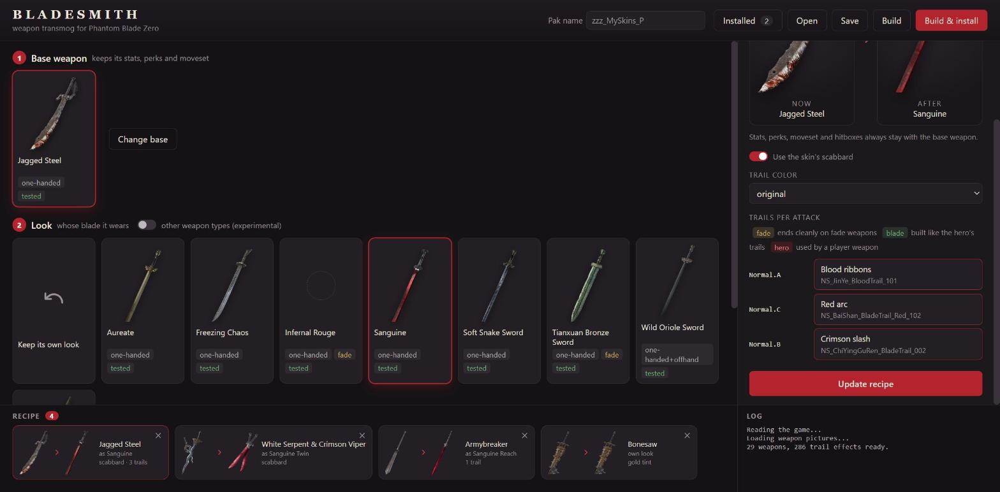</td>
    <td width="50%">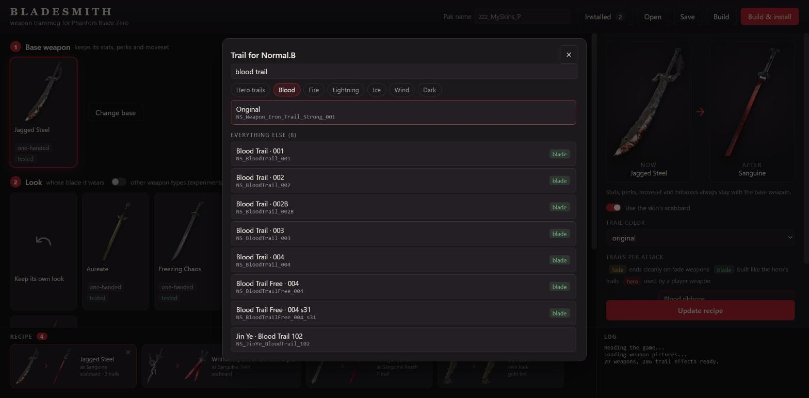</td>
  </tr>
  <tr>
    <td>A trail for each attack</td>
    <td>The trail picker: search, element filters and marks for fade, blade and hero trails</td>
  </tr>
</table>

<p align="center">
  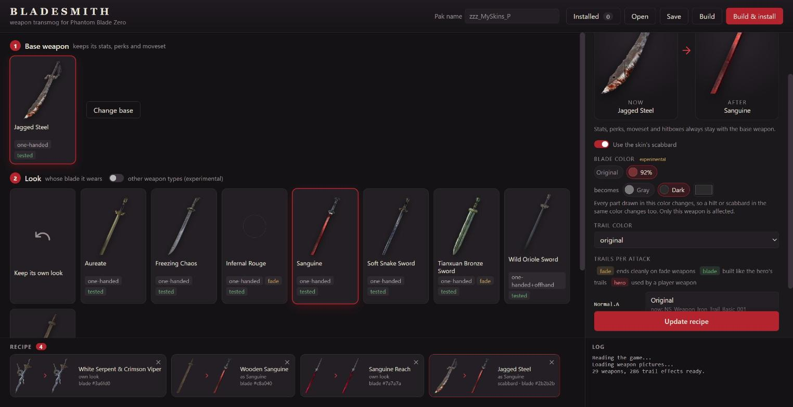
  <br><sub>Blade color: pick one of the look's colors and what it becomes</sub>
</p>

## In the game

Built with Bladesmith: the [Sanguine Skins](https://www.nexusmods.com/phantombladezero/mods/399) recipe from
`examples/`.

<p align="center">
  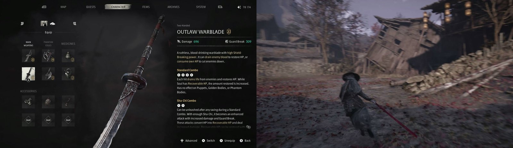
  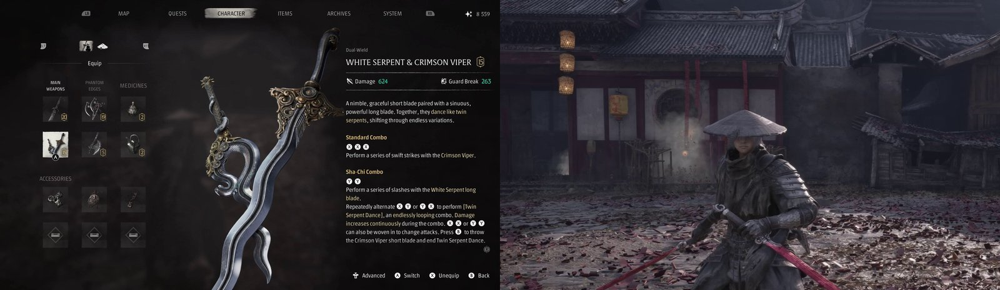
</p>

<table>
  <tr>
    <td width="50%">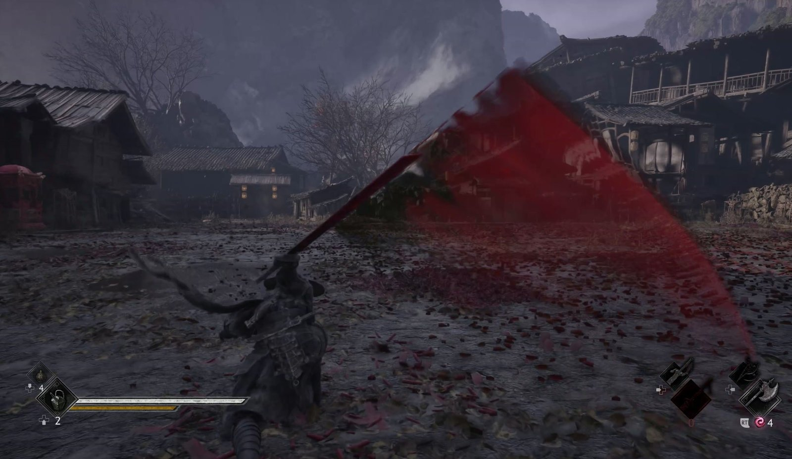</td>
    <td width="50%">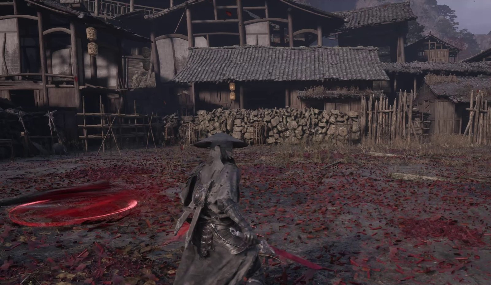</td>
  </tr>
  <tr>
    <td>Outlaw Warblade's own trails, recolored crimson</td>
    <td>Blood trails taken from an enemy weapon</td>
  </tr>
</table>

<p align="center">
  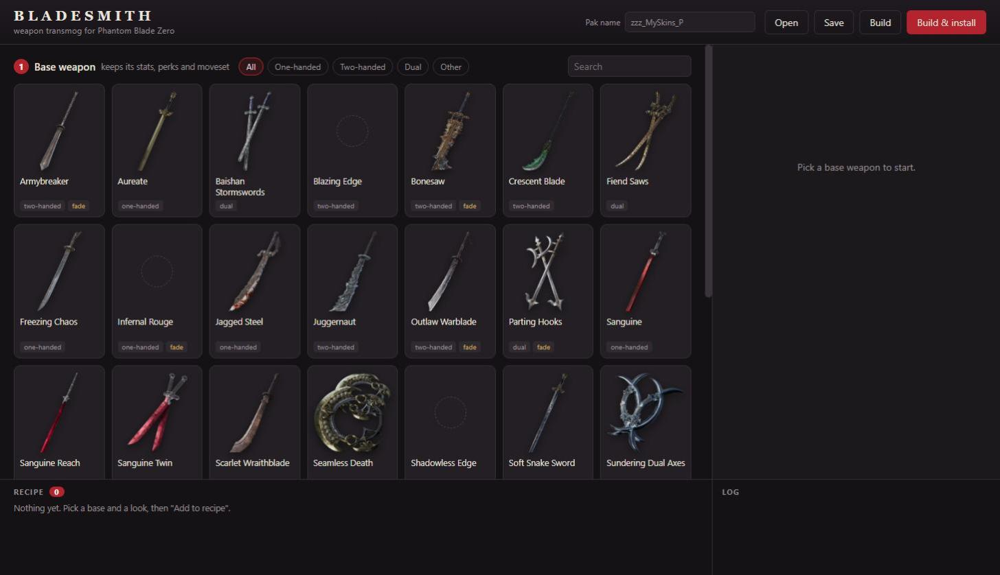
</p>

## Download

Get the latest `Bladesmith-*.zip` from [Releases](https://github.com/ayokiru/pbz-bladesmith/releases) or
[Nexus Mods](https://www.nexusmods.com/phantombladezero/mods/447), unpack it anywhere and
start `Bladesmith.exe`. It finds the game through Steam and asks for the folder if it can't. retoc, UAssetGUI and the
game's mappings come with it; the one thing to install is the
[.NET 8 Desktop Runtime (x64)](https://dotnet.microsoft.com/download/dotnet/8.0), and Bladesmith links to it if it is
missing.

Close the game before you press **Build & install**, since the game locks the files in `~mods`. Everything you
installed shows up under **Installed**, where you can open a pak's recipe again or remove it.

<p align="center">
  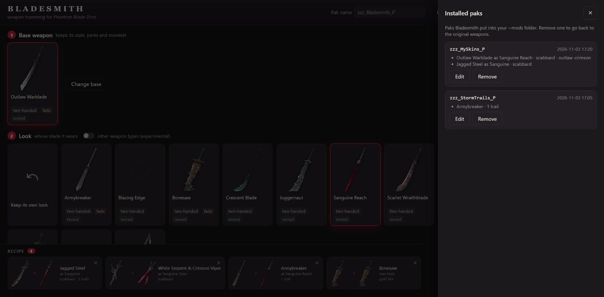
</p>

## Run from source

You need:

- Windows 10 or 11 and Python 3.11 or newer
- [retoc](https://github.com/trumank/retoc) built with [`patches/retoc-partitioned-ucas.patch`](patches/retoc-partitioned-ucas.patch).
  The game splits its main container into 50 files (`ProjectPBZ-Windows_s1.ucas` and so on), and upstream retoc only
  opens the first one.
- [UAssetGUI](https://github.com/atenfyr/UAssetGUI) 1.1.0
- The game's mappings: [USMAP File (Proper)](https://www.nexusmods.com/phantombladezero/mods/55) from Nexus Mods,
  saved as `%LOCALAPPDATA%\UAssetGUI\Mappings\PBZ.usmap`

Then:

```
git clone https://github.com/ayokiru/pbz-bladesmith
cd pbz-bladesmith
pip install pywebview pillow
copy bladesmith.example.toml bladesmith.toml
```

Set `game_dir` and the two tool paths in `bladesmith.toml`, and start the window:

```
python -m bladesmith gui
```

The first start takes a few seconds on game build 5.7.4-301524. After a game patch it takes a few minutes once, while
Bladesmith reads the weapons and checks every trail effect again.

## Command line

```
python -m bladesmith catalog                               # list the player weapons, write catalog.json
python -m bladesmith build examples/sanguine-skins.json    # build a pak from a recipe
python -m bladesmith build my-recipe.json --install        # build and copy it into ~mods
```

<details>
<summary><b>Recipe format</b></summary>

<br>

The window saves the same JSON, so you can start there and edit the file afterwards.

```json
{
  "pak_name": "zzz_MySkins_P",
  "fx_folder": "/PBZVFXPack/VFX/Bladesmith",
  "weapons": [
    {"base": "Iron", "skin": "Tang", "scabbard": true,
     "trails": {"Normal.A": "NS_JinYe_BloodTrail_101"}},
    {"base": "LuanYing_Evolution", "skin": "Tang", "slots": [0], "scabbard": true},
    {"base": "ZhanMaBlade", "skin": "Long", "scabbard": true, "trail_color": "outlaw-crimson"},
    {"base": "WoodenSword", "skin": "Tang", "blade_color": {"to": "#7a7a7a"}},
    {"base": "SnakeDual", "skin": "Double", "scabbard": true,
     "effect_meshes": [{"slot": 1, "system": "NS_SnakeDual_PhantomSword_001", "mesh": "SM_FX_DoubleBlade_101"}]}
  ]
}
```

| Field | Meaning |
|---|---|
| `pak_name` | File name of the pak. Letters, digits, `_` and `-`; `_P` is added if missing. |
| `fx_folder` | Where copied effects go. Optional. |
| `base`, `skin` | Weapon keys from `catalog.json`, the part after `Weapon_Hun_` (`Iron` is Jagged Steel). |
| `slots` | Which blades of the base get the skin. Default: all of them. |
| `scabbard` | Use the skin's scabbard. |
| `trails` | Attack tag pattern (the part after `Weapon.Trail.`, wildcards allowed) mapped to an effect name or path. |
| `trail_color` | A color preset from `bladesmith/presets` for the weapon's own trails. |
| `blade_color` | `to`: the new color as `#RRGGBB`. `from`: the hue to replace in degrees, by default the look's main color. Its usual shade becomes exactly `to`. |
| `effect_meshes` | Copy an effect attached to a blade with another mesh inside, like the ghost blade of the Crimson Viper throw. |

Each pak needs its own name. Two paks that change the same weapon conflict; paks for different weapons work together.

</details>

## How it works

Bladesmith converts the needed packages with retoc, edits them as JSON through UAssetGUI, and packs the result into
an IoStore pak. A blade skin points the weapon's blueprint at another skeletal mesh; scabbards and trails are fields
in the weapon's data asset. Trail colors live in material instances, in constants baked into the effect's scripts and
in color curves, so a preset patches all three in copies of the effect. A blade color changes the endpoint colors of
the compressed DXT1/DXT5 blocks in a copy of the texture, so the texture is never decoded and encoded again. A copy
of the material points at that texture, and the weapon's blueprint uses the copied material.

The examples rebuild the [Sanguine Skins](https://www.nexusmods.com/phantombladezero/mods/399) mod, and every file
matches the hand-made version that was tested in the game byte for byte. `python dev/parity.py` compares a build with
such a reference folder, and `python -m unittest` runs the checks that need no game files.

## Credits

- [retoc](https://github.com/trumank/retoc) by trumank and Archengius
- [UAssetGUI and UAssetAPI](https://github.com/atenfyr/UAssetGUI) by atenfyr
- [repak](https://github.com/trumank/repak) by trumank, used once to read the weapon names from the game
- Game mappings: [USMAP File (Proper)](https://www.nexusmods.com/phantombladezero/mods/55)

Phantom Blade Zero belongs to S-GAME. Bladesmith is a fan-made tool and is not affiliated with S-GAME.

## License

[MIT](LICENSE)
